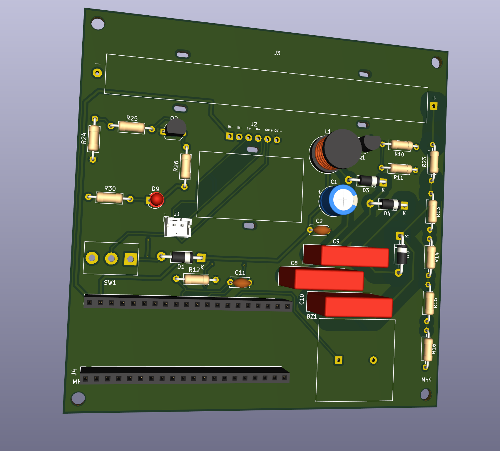
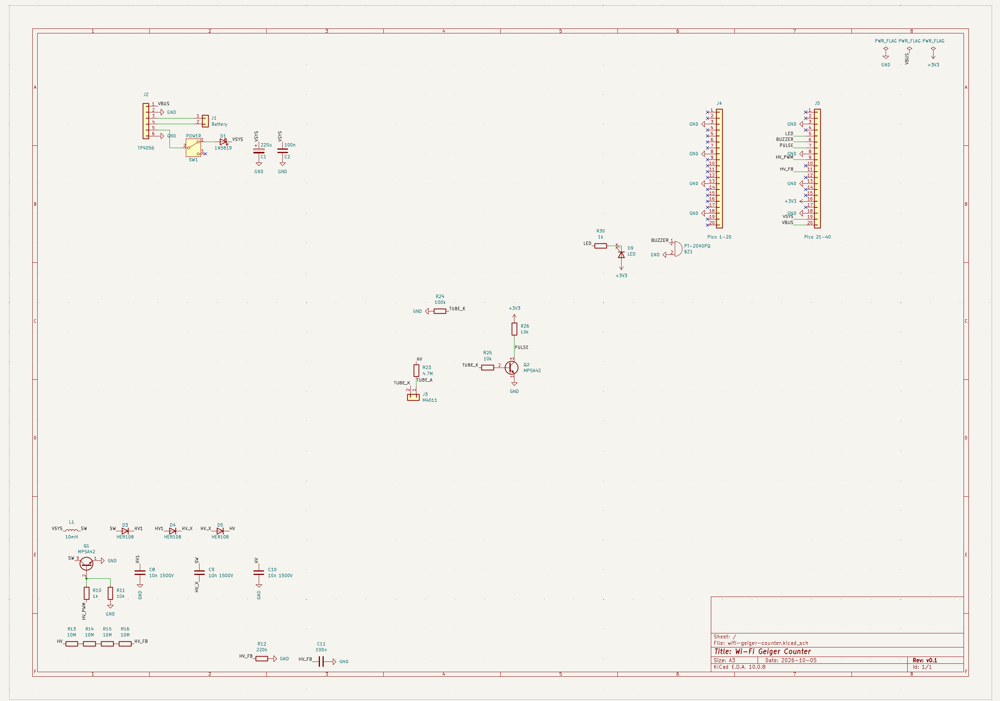
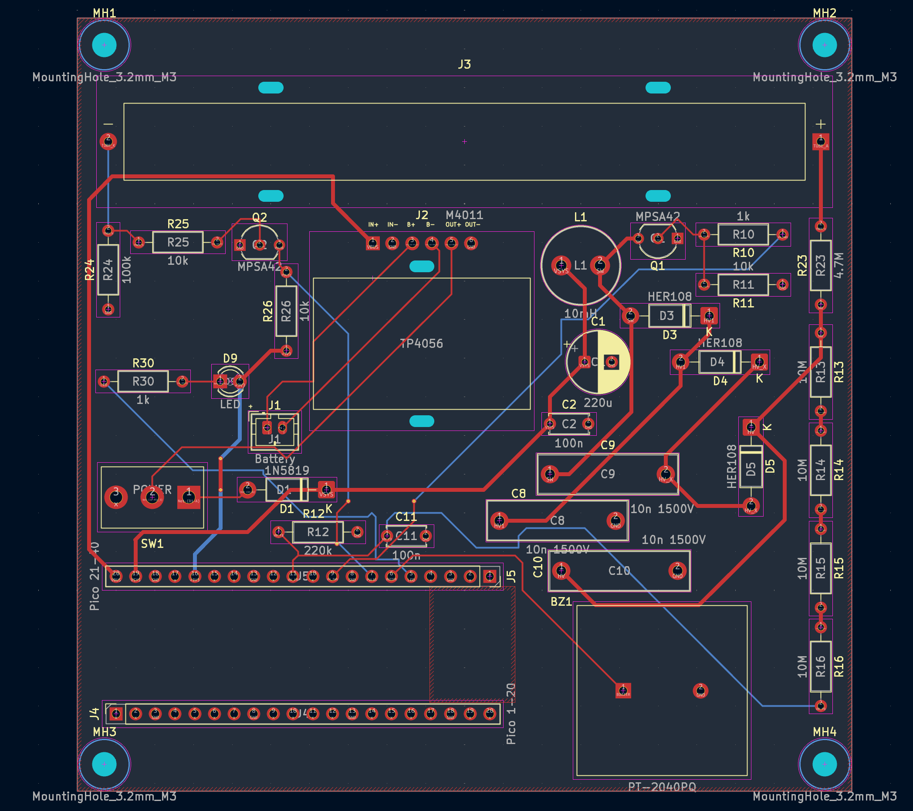

# Wi-Fi Geiger Counter

A DIY Geiger counter PCB which can detect ionizing radiation and log readings over Wi-Fi. Built with a Raspberry Pi Pico 2 W, and a HV multiplier circuit that steps up 3.7V to 400V for the GM tube. Made THT to be easily buildable.

## Features

- M4011/SBM-20 Geiger tube with pulse detection (tuned for M4011)
- Custom HV circuit (around 400V) with a single LiPo cell
- Wi-Fi data logging with a dashboard and a JSON API
- Piezo buzzer with clicking on each count
- Battery charging via the Pico's Micro-USB port
- Power switch
- Fully THT with parts from my local electronic shop (GM Electronic)

## Motivation
I made this project as I already own a FNIRSI GC-01 Geiger Counter, but I've always been intrigued by how they work and wanted to have a crack at making my own. It was an interesting challenge, especially given the difficulties around handling 400 volts, clearance, etc. Additionally, given the addition of Wi-Fi compared to the GC-01, I can log data from anywhere (the GC-01 requires a constant USB-C connection).

## Functionality
- Power from the Pico's Micro-USB goes through the VBUS to a TP4056 charger module which charges the battery. 
- Pico uses PWM on a MPSA42 transistor which switches an inductor, it ramps up to 200V-ish and then a diode + capacitor voltage doubler ups that to around 400V.
- A 40Megaohm/220kiloohm resistor divider reduces the 400V down to around 2.19, which is read by the Pico via its ADC and PID in the firmware adjusts to continuously hold at 400V.
- When the M4011 tube detects decay, the pulse enters a transistor and it is turned into a 3.3V signal for the Pico which is counted and clicks the buzzer.
- The firmware tallies counts over 60 seconds to calculate a CPM and converts into micro Sv/h via the configured conversion factor. Pico hosts a small web page and a JSON endpoint.

## How it was made
This is my first project in KiCad, so I had to figure it out for the most part. I picked the parts on LCSC and imported them, sketched the HV circuit on paper and then built it step by step. A few issues I ran into:
- I configured net class patterns to keep HV clearance, but I misconfigured them (set to HV instead of /HV) and they were ignored. As such, when I thought I was done, none of my rules were actually checked.
- My USB TVS diode was wired the wrong way which would short VBUS. I swapped it for a bidirectional one.
- My status LED was backwards and improperly wired, so I changed it to stay high on boot.
- The USB-C connector was facing inside the board instead of outside, very easy mistake to make in the PCB editor! Had to rotate and reroute completely.
- The buzzer footprint didn't match my actual part, so I had to find the right one on LCSC and reimport it.
- The ADC reading was wrong by around 30% in the firmware, so I fixed it by using the calibrated ADC reading in MicroPython

### v2 (THT)
After my project got approved, I realized it was practically unbuildable, as the ESP32 had pads underneath and everything was tiny SMD, which for a beginner solderer like me was straight up impossible. As I had no hot air or hot plate (I only have a Pinecil), I redesigned it to be THT from my local retailer, which even saved some costs.

## Tech stack
- KiCad for the PCB design
- MicroPython for the Pico firmware
- JLCPCB for the board and GM Electronic for parts

## Repo layout
- pcb/ contains the actual KiCad project
- pcb/gerbers contain the gerber and drill files
- pcb/lib/ contains my custom footprints
- firmware/ contains the MicroPython code
- images/ contains a render of the PCB and other images
- BOM.csv contains the parts list
- JOURNAL.md is the devlog

## Bill of materials

| Part | Qty | Source | Unit | Total |
|---|---|---|---|---|
| [PCB Manufacturing](https://jlcpcb.com) | 1 | JLCPCB | $4.00 | $4.00 |
| [RASPBERRY Pico 2 WH](https://www.gme.cz/v/1517388/raspberry-pico-2-wh) | 1 | GM Electronic | $11.97 | $11.97 |
| [CONNFLY BL120G-V8.5 female header 1x20pin](https://www.gme.cz/v/1498892/connfly-bl120g-v85-dutinkova-lista-1x20pin-roztec-254mm-vyska-85mm) | 2 | GM Electronic | $0.44 | $0.88 |
| [CREATALL CA-033M TP4056 charger module](https://www.gme.cz/v/1518943/creatall-ca-033m-nabijecka-li-ion-clanku-tp4056-s-ochranou-microusb) | 1 | GM Electronic | $0.88 | $0.88 |
| [SEMTECH MPSA42 transistor](https://www.gme.cz/v/1485978/semtech-mpsa42-b-p-bipolarni-tranzistor) | 8 | GM Electronic | $0.13 | $1.04 |
| [FASTRON 09P-103J inductor 10mH](https://www.gme.cz/v/1487059/fastron-09p-103j-tlumivka) | 1 | GM Electronic | $0.91 | $0.91 |
| [HER108 diode](https://www.gme.cz/v/1493669/her108-dioda) | 12 | GM Electronic | $0.09 | $1.08 |
| [WIMA MKS4 10n/1500V](https://www.gme.cz/v/1491351/wima-mks4-10n-1500v-k-rm15-foliovy-kondenzator) | 3 | GM Electronic | $0.67 | $2.01 |
| [1N5819 Schottky](https://www.gme.cz/v/1493662/1n5819-schottkyho-dioda) | 6 | GM Electronic | $0.14 | $0.84 |
| [Resistor 1 kiloohm 0207](https://www.gme.cz/v/1486228/gym-cym-rm-1k-06w-1-0207-metalizovany-rezistor) | 10 | GM Electronic | $0.10 | $1.00 |
| [Resistor 10 kiloohm 0207](https://www.gme.cz/v/1494150/gym-cym-rm-10k-06w-1-0207-metalizovany-rezistor) | 10 | GM Electronic | $0.10 | $1.00 |
| [Resistor 100 kiloohm 0207](https://www.gme.cz/v/1494147/gym-cym-rm-100k-06w-1-0207-metalizovany-rezistor) | 10 | GM Electronic | $0.10 | $1.00 |
| [Resistor 220 kiloohm 0207](https://www.gme.cz/v/1493098/gym-cym-rm-220k-06w-1-0207-metalizovany-rezistor) | 10 | GM Electronic | $0.10 | $1.00 |
| [Resistor 4.7 megaohm 0207](https://www.gme.cz/v/1493090/gym-cym-rm-4m7-06w-1-0207-metalizovany-rezistor) | 10 | GM Electronic | $0.10 | $1.00 |
| [Resistor 10 megaohm 0207](https://www.gme.cz/v/1494151/gym-cym-rm-10m-06w-1-0207-metalizovany-rezistor) | 10 | GM Electronic | $0.10 | $1.00 |
| [GYM/CYM CK 100n/63V](https://www.gme.cz/v/1489722/gym-cym-ck-100n-63v-x7r-rm508-20-keramicky-kondenzator) | 4 | GM Electronic | $0.18 | $0.72 |
| [HITANO CE 220u/16V 8x12](https://www.gme.cz/v/1485860/hitano-ce-220u-16vit-hit-exr-8x12-rm35-bulk-elektrolyticky-kondenzator) | 5 | GM Electronic | $0.15 | $0.75 |
| [BRIGHT LED BL-B5141-L red](https://www.gme.cz/v/1492965/bright-led-bl-b5141-l-led-3mm-cervena) | 1 | GM Electronic | $0.17 | $0.17 |
| [HITPOINT PT-2040PQ piezo](https://www.gme.cz/v/1496868/hitpoint-pt-2040pq-piezomenic) | 1 | GM Electronic | $0.84 | $0.84 |
| [MTS-102-A2 toggle](https://www.gme.cz/v/1501004/mts-102-a2-packovy-spinac) | 1 | GM Electronic | $0.65 | $0.65 |
| [JST PH 2pin header](https://www.gme.cz/v/1517850/jst-ph-20mm-2pin-konektor-na-dps) | 2 | GM Electronic | $0.11 | $0.22 |
| [JST PH 3pin cable](https://www.gme.cz/v/1517846/jst-ph-20mm-3pin-samice) | 2 | GM Electronic | $0.37 | $0.74 |
| [KSS KDA6M3X15W standoff](https://www.gme.cz/v/1483417/kss-kda6m3x15w-polyamid-bily-distancni-sloupek-15mm-m3-matka-sroub) | 4 | GM Electronic | $0.23 | $0.92 |
| [WURTH SKM3K nut M3](https://www.gme.cz/v/1511808/wurth-skm3k-matice-m3) | 4 | GM Electronic | $0.03 | $0.12 |
| [KSS CV-100 zip tie](https://www.gme.cz/v/1512662/kss-cv-100-stahovaci-pasek) | 8 | GM Electronic | $0.03 | $0.24 |
| [GM Tube - M4011](https://github.com/SensorsIot/Geiger-Counter-RadiationD-v1.1-CAJOE-/blob/master/M4011%20Geiger%20Tube%20Specification.pdf) | 1 | Salvaged (FNIRSI GC-01) | $0.01 | $0.01 |
| 3.7V LiPo battery | 1 | Salvaged (FNIRSI GC-01) | $0.01 | $0.01 |
| **Parts subtotal** | | | | **$35.00** |
| Shipping (estimate) | | | | $11.00 |
| **Total** | | | | **$46.00** |

The Geiger Tube and Battery were salvaged from my GC-01, so they're effectively free. You can buy similar pieces on Ebay, Aliexpress or other stores.

## Assembly
Please keep in mind the board makes around 400V, even though it's low current, it could still inflict a shock, as such, please be careful. Before touching the HV side, I recommend unplugging the USB and battery and shorting C10 to GND to discharge it.

1. Order the PCB from JLCPCB using the gerber files and the parts from GM using the BOM.
2. Start with the power section. Put a piece of electrical tape where the TP4056 module goes, zip tie the module on and wire its 6 pads to J2 following the silkscreen labels. Then solder D1, C1 (polarity!), C2, SW1 and the J1 battery connector. Check battery polarity before plugging in or you might kill it! If you turn on SW1, you should get the battery voltage (4Vish) on VSYS.
3. Solder the Pico sockets, led + R30, buzzer. Plug in the RPi with the usb port facing the left edge of the PCB. Flash Micropython.
4. Begin the HV supply. Solder Q1, R10, R11, L1, D3-D5, C8-C10, divider chain R13-R16, R12, C11, R23. Do not connect the tube yet. Run the firmware and see how much HV you get. Do not measure with a multimeter to avoid loading the circuit.
5. Now for the pulse detection, solder Q2, R24, R25 and R26.
6. To finish, zip tie your tube onto J3 and solder leads. VERIFY ANODE AND CATHODE! Screw in the four standoffs and connect the battery.

## Firmware

1. Start by downloading MicroPython for the Pico 2 W from [micropython.org](https://micropython.org/download/RPI_PICO2_W/). Hold the BOOTSEL button on the Pico while plugging in and drag the .uf2 onto the drive that shows up.
2. Fill in firmware/config.py.
3. Copy over files: config.py, geiger.py, hv_control.py, buzzer.py, wifi_manager.py, main.py.
4. If all goes well, your IP address should get printed over serial. Try opening it in the browser for the dashboard, or use /api/data for the JSON data.

## AI disclosure
LLMs (Claude Opus 4.6/5.5) was mostly used to get feedback on the schematic, review parts of it, assist in fixing bugs and writing the dashboard in wifi_manager.py. It was also used for other tedious but simple tasks, such as adding the BOM to this README.

---

Built for [Hack Club Half Life](https://halflife.hackclub.com/) 
Week 1 (PCBs).
