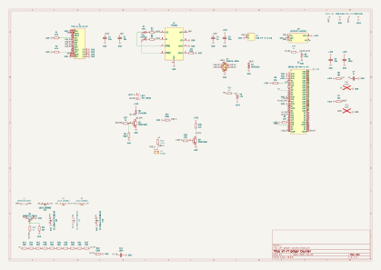
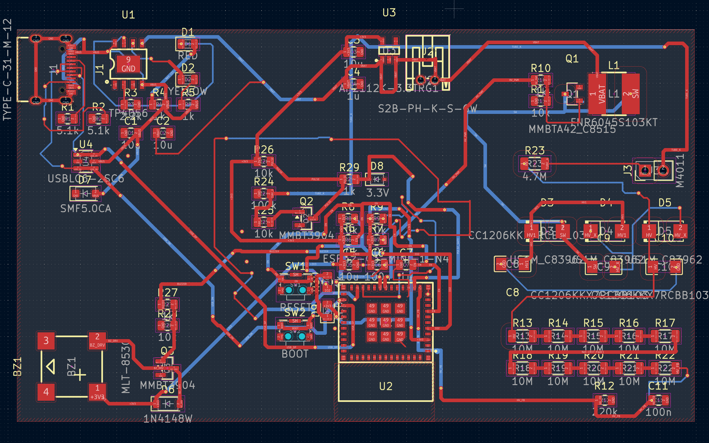

# Wi-Fi Geiger Counter

A DIY Geiger counter PCB which can detect ionizing radiation and log readings over Wi-Fi. Built with an ESP32, and a HV multiplier circuit that steps up 3.7V to 400V for the GM tube.






## Features

- M4011/SBM-20 Geiger tube with pulse detection (tuned for M4011)
- Custom HV circuit (around 400V) with a single LiPo cell
- Wi-Fi data logging with a dashboard and a JSON API
- Buzzer with clicking on each count
- USB-C charging
- ESD and overvoltage protection

## Motivation
I made this project as I already own a FNIRSI GC-01 Geiger Counter, but I've always been intrigued by how they work and wanted to have a crack at making my own. It was an interesting challenge, especially given the difficulties around handling 400 volts, clearance, etc. Additionally, given the addition of Wi-Fi compared to the GC-01, I can log data from anywhere (the GC-01 requires a constant USB-C connection).

## Functionality
- Power from USB-C goes into a TP4056 which charges the LiPo battery. An AP2112K reduces the voltage from the battery to 3.3V to be safe for the ESP32.
- ESP32 uses PWM on a MMBTA42 transistor which switches an inductor, it ramps up to 200V-ish and then a diode + capacitor voltage doubler ups that to around 400V.
- A 100Megaohm/220kiloohm resistor divider reduces the 400V down to around 0.88, which is read by the ESP32 via its ADC and PID in the firmware adjusts to continuously hold at 400V.
- When the M4011 tube detects decay, the pulse enters a transistor and it is turned into a 3.3V signal for the ESP32 which is counted and clicks the buzzer.
- The firmware tallies counts over 60 seconds to calculate a CPM and converts into micro Sv/h via the configured conversion factor. ESP32 hosts a small web page and a JSON endpoint.

## How it was made
This is my first project in KiCad, so I had to figure it out for the most part. I picked the parts on LCSC and imported them, sketched the HV circuit on paper and then built it step by step. A few issues I ran into:
- I configured net class patterns to keep HV clearance, but I misconfigured them (set to HV instead of /HV) and they were ignored. As such, when I thought I was done, none of my rules were actually checked.
- My USB TVS diode was wired the wrong way which would short VBUS. I swapped it for a bidirectional one.
- My status LED was backwards and improperly wired, so I changed it to stay high on boot.
- The USB-C connector was facing inside the board instead of outside, very easy mistake to make in the PCB editor! Had to rotate and reroute completely.
- The buzzer footprint didn't match my actual part, so I had to find the right one on LCSC and reimport it.
- The ADC reading was wrong by around 30% in the firmware, so I fixed it by using the calibrated ADC reading in MicroPython

## Tech stack
- KiCad for the PCB design
- MicroPython for the ESP32 firmware
- JLCPCB for the board and LCSC for parts

## Repo layout
- pcb/ contains the actual KiCad project
- pcb/gerbers contain the gerber and drill files
- pcb/cpl/ contains the component positions
- firmware/ contains the MicroPython code
- images/ contains a render of the PCB
- BOM.csv contains the parts list
- JOURNAL.md is the devlog

## Bill of materials

| Part | Qty | Source | Unit | Total |
|---|---|---|---|---|
| [PCB Manufacturing](https://jlcpcb.com) | 1 | JLCPCB | $4.00 | $4.00 |
| [ESP32-C3-MINI](https://www.lcsc.com/product-detail/C2838502.html) | 1 | LCSC | $3.06 | $3.06 |
| [TP4056-42-ESOP8](https://www.lcsc.com/product-detail/C16581.html) | 5 | LCSC | $0.19 | $0.95 |
| [AP2112K-3.3TRG1](https://www.lcsc.com/product-detail/C51118.html) | 5 | LCSC | $0.18 | $0.90 |
| [USBLC6-2SC6](https://www.lcsc.com/product-detail/C7519.html) | 5 | LCSC | $0.18 | $0.90 |
| [MMBTA42](https://www.lcsc.com/product-detail/C94389.html) | 10 | LCSC | $0.05 | $0.50 |
| [MMBT3904](https://www.lcsc.com/product-detail/C242260.html) | 20 | LCSC | $0.04 | $0.80 |
| [US1M](https://www.lcsc.com/product-detail/C81191.html) | 3 | LCSC | $0.05 | $0.15 |
| [1N4148W](https://www.lcsc.com/product-detail/C917030.html) | 50 | LCSC | $0.01 | $0.50 |
| [SMF5.0CA](https://www.lcsc.com/product-detail/C908214.html) | 20 | LCSC | $0.02 | $0.40 |
| [MM3Z3V3](https://www.lcsc.com/product-detail/C52056.html) | 50 | LCSC | $0.02 | $1.00 |
| [Red LED 0805](https://www.lcsc.com/product-detail/C84256.html) | 50 | LCSC | $0.02 | $1.00 |
| [Yellow LED 0805](https://www.lcsc.com/product-detail/C84261.html) | 20 | LCSC | $0.02 | $0.40 |
| [MLT-8530](https://www.lcsc.com/product-detail/C94599.html) | 5 | LCSC | $0.21 | $1.05 |
| [FNR6045S103KT](https://www.lcsc.com/product-detail/C168108.html) | 5 | LCSC | $0.25 | $1.25 |
| [TYPE-C-31-M-12](https://www.lcsc.com/product-detail/C165948.html) | 5 | LCSC | $0.18 | $0.90 |
| [S2B-PH-K-S-GW](https://www.lcsc.com/product-detail/C157932.html) | 5 | LCSC | $0.17 | $0.85 |
| [1k 0805](https://www.lcsc.com/product-detail/C17513.html) | 100 | LCSC | $0.01 | $1.00 |
| [10k 0805](https://www.lcsc.com/product-detail/C17414.html) | 100 | LCSC | $0.01 | $1.00 |
| [5.1k 0805](https://www.lcsc.com/product-detail/C27834.html) | 100 | LCSC | $0.01 | $1.00 |
| [2.2k 0805](https://www.lcsc.com/product-detail/C17520.html) | 100 | LCSC | $0.01 | $1.00 |
| [220k 0805](https://www.lcsc.com/product-detail/C17556.html) | 100 | LCSC | $0.01 | $1.00 |
| [100k 0805](https://www.lcsc.com/product-detail/C17407.html) | 100 | LCSC | $0.01 | $1.00 |
| [4.7M 1206 500V](https://www.lcsc.com/product-detail/C510138.html) | 10 | LCSC | $0.01 | $0.10 |
| [10M 1206](https://www.lcsc.com/product-detail/C2933576.html) | 100 | LCSC | $0.01 | $1.00 |
| [10µF 0805](https://www.lcsc.com/product-detail/C15850.html) | 20 | LCSC | $0.07 | $1.40 |
| [1µF 0805](https://www.lcsc.com/product-detail/C28323.html) | 10 | LCSC | $0.04 | $0.40 |
| [100nF 0805](https://www.lcsc.com/product-detail/C49678.html) | 20 | LCSC | $0.02 | $0.40 |
| [10nF 1kV 1206](https://www.lcsc.com/product-detail/C107192.html) | 20 | LCSC | $0.03 | $0.60 |
| [GM Tube - M4011](https://github.com/SensorsIot/Geiger-Counter-RadiationD-v1.1-CAJOE-/blob/master/M4011%20Geiger%20Tube%20Specification.pdf) | 1 | Salvaged (FNIRSI GC-01) | $0.01 | $0.01 |
| 3.7V LiPo battery | 1 | Salvaged (FNIRSI GC-01) | $0.01 | $0.01 |
| [2.54-1*3P](https://www.lcsc.com/product-detail/C49257.html) | 20 | LCSC | $0.03 | $0.60 |
| **Parts subtotal** | | | | **$29.13** |
| Shipping (estimate) | | | | $25.00 |
| **Total** | | | | **$54.13** |

The Geiger Tube and Battery were salvaged from my GC-01, so they're effectively free. You can buy similar pieces on Ebay, Aliexpress or other stores.

## Assembly
Please keep in mind the board makes around 400V, even though it's low current, it could still inflict a shock, as such, please be careful. Before touching the HV side, I recommend unplugging the USB and battery and shorting C10 to GND to discharge it.

1. Order the PCB from JLCPCB using the gerber files and the parts from LCSC using the BOM.
2. Start with the power section. Solder the USB-C connector, USBLC6, TVS diode, TP4056, AP2112K and their resistors + capacitors. Do not work with the battery yet. Plug in USB-C and verify that the charge LED turns on. You should be getting 3.3V.
3. Solder the ESP32-C3-MINI-1 and the status LED. The ESP32 has pads underneath, so you'll need hot air or a hot plate for it. Flash MicroPython (more below) and check that you get a REPL on the ESP32.
4. Begin the HV supply. Solder Q1, L1, US1M diodes, 10nF 1kV capacitors and the 10 megaohm resistor divider chain but avoid connecting the tube at this point. Run the firmware and see the HV values it prints. I recommend not trying to measure the 400V with a multimeter as the 10 megaohm input can load the circuit.
5. Now for the pulse detection and the buzzer, solder Q2, Q3, the buzzer and the rest.
6. To finish, you can plug your tube into J3 (verify anode and cathode!!!) and connect the battery.

Keep in mind I intentionally avoid populating SW1 (reset) and SW2 (boot) switches for simplicity, but you may do so yourself if you want to (they're excluded from the BOM). If you ever need them, you can short their pads. The ESP32 can be flashed over USB without requiring the boot switch, as you can see below.

## Firmware

1. Start by downloading MicroPython for the ESP32-C3 from [micropython.org](https://micropython.org/download/ESP32_GENERIC_C3/) and flash it:
```sh
pip install esptool
esptool.py --chip esp32c3 erase_flash
esptool.py --chip esp32c3 write_flash -z 0x0 ESP32_GENERIC_C3-<your_version>.bin
```
2. Put your Wi-Fi name and password in firmware/config.py
3. Copy the files over:
```sh
pip install mpremote
cd firmware
mpremote cp config.py geiger.py hv_control.py buzzer.py wifi_manager.py main.py :
mpremote reset
```
4. If all goes well, your IP address should get printed over serial. Try opening it in the browser for the dashboard, or use /api/data for the JSON data.

## AI disclosure
LLMs (Claude Opus 4.6/5.5) was mostly used to get feedback on the schematic, review parts of it, assist in fixing bugs and writing the dashboard in wifi_manager.py. It was also used for other tedious but simple tasks, such as adding the BOM to this README.

---

Built for [Hack Club Half Life](https://halflife.hackclub.com/) 
Week 1 (PCBs).
